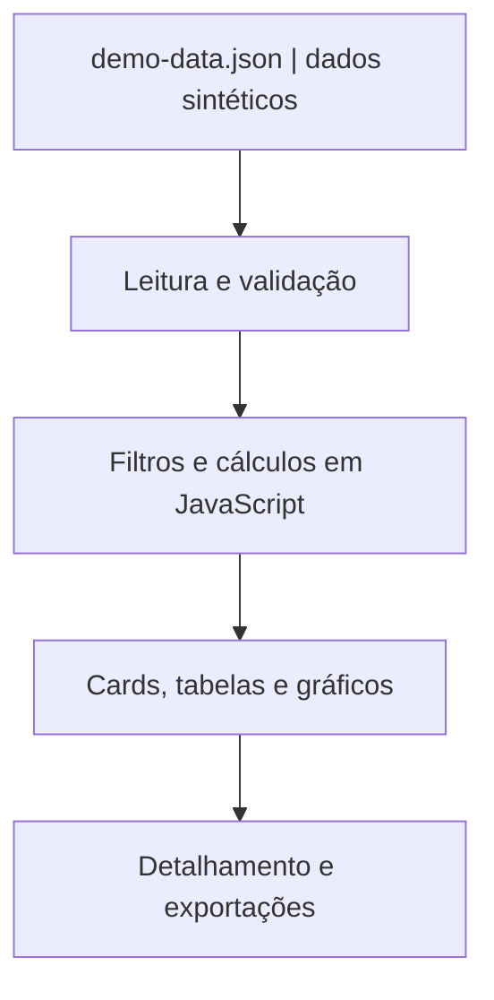

# ProdPulse | Dashboard Interativo de Produção

**Aplicação web para visualização de indicadores de produção, construída com HTML, CSS e JavaScript puro.**

O ProdPulse apresenta uma interface interativa para acompanhar carteiras de produção, identificar pendências, comparar resultados planejados e concluídos e explorar indicadores por período, linha, modelo e cliente. O repositório reúne o código-fonte, a documentação técnica e uma base demonstrativa pronta para execução local ou hospedagem estática.

> **Ambiente de demonstração.** Todos os clientes, pedidos, códigos, lotes, modelos e resultados apresentados são fictícios. O projeto é independente de serviços externos e utiliza somente os arquivos incluídos no repositório.

## Sumário

1. [Visão geral](#visão-geral)
2. [Funcionalidades](#funcionalidades)
3. [Regras dos indicadores](#regras-dos-indicadores)
4. [Como o projeto foi construído](#como-o-projeto-foi-construído)
5. [Tecnologias](#tecnologias)
6. [Estrutura do projeto](#estrutura-do-projeto)
7. [Formato dos dados](#formato-dos-dados)
8. [Como executar](#como-executar)
9. [Publicação no GitHub Pages](#publicação-no-github-pages)
10. [Privacidade e limitações](#privacidade-e-limitações)

## Visão geral

O **ProdPulse** é uma aplicação web de página única (*single-page dashboard*) que reúne uma visão executiva e ferramentas de análise operacional. Os módulos permitem navegar de indicadores consolidados até registros individuais, com filtros interativos, metas, gráficos, rankings e exportação de resultados.

### Perguntas que o dashboard ajuda a responder

- Quantas unidades estão **planejadas, concluídas e pendentes** no período?
- Qual é o **percentual de conclusão** da carteira filtrada?
- Quais modelos concentram o **maior volume de pendências**?
- Qual deve ser a **média diária necessária** para concluir a carteira?
- Como está o **atingimento da meta mensal** em relação ao período anterior?
- Como evolui o **índice de produção diária** de cada família?
- Qual é a participação de cada produto no **mix planejado**?
- Quais registros específicos compõem um indicador e podem ser exportados?

## Funcionalidades

| Módulo | O que faz |
| --- | --- |
| **Indicadores principais** | Cards de unidades planejadas, concluídas, pendentes e percentual de conclusão, recalculados com os filtros. |
| **Filtros dinâmicos** | Seleção de mês, família e cliente fictício; pesquisa por código do item, pedido, lote, cliente e modelo. |
| **Resumo executivo** | Destaca o volume de pendências e identifica grupos com baixo percentual de conclusão. |
| **Meta diária** | Estima dias restantes, média necessária por dia, meta do dia e distribuição sugerida por modelo. Permite simular paradas extras. |
| **Meta mensal** | Meta automática igual ao total planejado ou meta manual; gráfico circular de progresso, saldo restante e comparação com o mês anterior. |
| **Acompanhamento por modelo** | Compara planejado, concluído, pendente e avanço percentual; permite filtrar situação e ordenar resultados. |
| **Ranking de prioridades** | Mostra os cinco modelos com maior quantidade pendente no período. |
| **Detalhamento** | Modal com registros relacionados ao modelo, pesquisa, filtros de concluídos/pendentes e seleção de um item. |
| **Exportação** | Gera CSV com registros do detalhamento e TXT com resumo textual da meta. |
| **Índice de produção** | Gráfico em Canvas da média diária por família e da média total ao longo dos meses, com modo de tela cheia. |
| **Mix de produtos** | Barras de planejado versus concluído, participação percentual no mix, busca e ordenação. |
| **Ilustrações** | SVGs próprios para os oito modelos fictícios, exibidos nas áreas de visualização. |
| **Atualização local** | Recarrega exclusivamente a base JSON fictícia fornecida com o projeto, sem endpoint externo configurável. |

### Interação e apresentação

- Interface responsiva, com cartões, painéis translúcidos e estilo *glassmorphism*;
- Formatação de números e datas em português brasileiro;
- Cores de status e indicadores de progresso;
- Atualização do conteúdo sem recarregar a página inteira;
- Animações com consideração à preferência do usuário por movimento reduzido;
- Modal com fechamento por `Esc`, tratamento de foco e atributos de acessibilidade.

## Regras dos indicadores

As regras abaixo explicam a lógica usada **nesta simulação**, não dados ou metas reais de uma organização.

| Indicador | Cálculo / regra ilustrativa |
| --- | --- |
| **Planejado** | Quantidade de registros no mês e nos filtros selecionados. |
| **Concluído** | Quantidade de registros com data válida de conclusão (`quality`). |
| **Pendente** | `planejado - concluído`. |
| **Conclusão (%)** | `(concluído / planejado) × 100`, quando houver planejados. |
| **Meta mensal** | Total planejado por padrão, com possibilidade de informar um objetivo manual. |
| **Atingimento da meta (%)** | `(concluído / meta) × 100`. |
| **Média diária necessária** | `pendentes / dias produtivos restantes`. |
| **Meta sugerida para hoje** | Arredondamento para cima da média diária necessária. |
| **Participação no mix (%)** | `(planejado do modelo / planejado total filtrado) × 100`. |
| **Índice diário por família** | Quantidade concluída no mês / dias produtivos estimados no mês. |

O cálculo de meta diária usa **22 dias como parâmetro inicial ilustrativo**, desconta feriados considerados na simulação e permite adicionar paradas extras. Os resultados variam conforme o mês, a data atual e o contexto filtrado. Metas manuais existem apenas durante a sessão da página; não são gravadas em banco de dados.

## Como o projeto foi construído

O front-end foi organizado em módulos com responsabilidades diferentes, sem dependência de React, Angular, bibliotecas de gráficos ou serviços externos.

**1. Modelagem dos dados**

Foi definido um contrato JSON com campos de planejamento, identificação de registros, família, modelo, cliente fictício e conclusão. Um segundo conjunto (`indexRecords`) alimenta a análise histórica do índice de produção.

**2. Tratamento e validação**

O arquivo `demo-data.json` é carregado com a API `fetch()`. Antes de entregar os registros à interface, o módulo de leitura verifica o marcador da demonstração, a estrutura das listas, o padrão dos identificadores sintéticos e o limite de **dez clientes**. Uma base fora desse padrão é rejeitada.

**3. Regras de negócio no navegador**

O JavaScript agrupa os registros, interpreta datas, aplica filtros e calcula os indicadores. Os resultados são gerados dinamicamente no navegador; não existe uma API de processamento nem banco de dados nesta versão.

**4. Visualização e componentes**

O HTML fornece a estrutura dos painéis e formulários. O CSS controla o layout responsivo, os estados e os efeitos visuais. O JavaScript renderiza tabelas, cards, barras de progresso e gráficos; o histórico de médias usa a **Canvas API**.

**5. Interatividade e exportação**

Eventos de seleção, digitação e clique atualizam os painéis relevantes. A exportação CSV/TXT é produzida no navegador por `Blob` e download local, sem envio dos dados a outro serviço.

**6. Isolamento da demonstração**

Um servidor HTTP simples em Python disponibiliza os arquivos localmente. Ele escolhe automaticamente uma porta disponível e utiliza `localhost` (endereço de retorno do próprio computador), evitando conflito com outras aplicações. A versão estática também pode ser hospedada no GitHub Pages.



## Tecnologias

| Tecnologia | Utilização |
| --- | --- |
| **HTML5** | Estrutura semântica, filtros, painéis e modal. |
| **CSS3** | Responsividade, componentes visuais, transições e glassmorphism. |
| **JavaScript (Vanilla)** | Regras de cálculo, filtros, gráficos, eventos e renderização da interface. |
| **Canvas API** | Desenho do gráfico histórico de produtividade. |
| **Fetch API + JSON** | Leitura da base demonstrativa estática. |
| **SVG** | Ilustrações vetoriais fictícias dos modelos. |
| **Python 3 (biblioteca padrão)** | Servidor HTTP local para executar a demonstração. |

**Não é necessário instalar `npm`, pacotes de front-end ou dependências de terceiros.** Python só é necessário para iniciar a versão local pelo script fornecido.

## Estrutura do projeto

```text
prodpulse-demo/
├── index.html                 # Página principal
├── demo-data.json             # Base 100% fictícia
├── INICIAR_DEMO.bat           # Inicialização no Windows
├── SERVIDOR_DEMO.py           # Servidor local em porta dinâmica
├── README.md                  # Documentação do projeto
├── .gitignore
├── css/
│   └── styles.css             # Layout, estilo e responsividade
├── js/
│   ├── config.js              # Identificação e configuração da demo
│   ├── live-client.js         # Leitura/validação do JSON local
│   ├── app.js                 # Cálculos e componentes do dashboard
│   ├── main.js                # Eventos e inicialização
│   ├── media-config.js        # Mapeamento dos SVGs fictícios
│   ├── ui-motion.js           # Animações de indicadores
│   └── version.js             # Identificação visual da versão
├── assets/
│   └── images/products/       # Oito ilustrações SVG
└── docs/
    └── PRIVACIDADE.md         # Cuidados antes da publicação
```

## Formato dos dados

O arquivo `demo-data.json` contém **349 registros demonstrativos**, distribuídos entre **10 clientes fictícios** e oito modelos inventados. A base foi gerada de forma determinística, do zero, sem copiar ou anonimizar superficialmente registros de produção reais.

Exemplo simplificado de um objeto válido:

```json
{
  "updatedAt": "2026-10-26T12:00:00Z",
  "source": "DEMONSTRACAO - BASE TOTALMENTE SINTETICA",
  "records": [
    {
      "sheet": "LINHA A",
      "family": "LINHA A",
      "lot": "DEMO-LOTE-00001",
      "planned": "2026-10-10",
      "order": "EXEMPLO-PED-12345-0001",
      "tc": "ITEM-FICT-ORION-00001",
      "client": "Cliente Fictício 01",
      "box": "Modelo Orion",
      "quality": "2026-10-12",
      "qualityRaw": ""
    }
  ],
  "indexRecords": [
    { "family": "LINHA A", "date": "2026-10-12" }
  ]
}
```

O exemplo ilustra o formato, não um registro específico da base. O campo `quality` representa a data de conclusão simulada; vazio significa pendência. A propriedade `indexRecords` contém eventos de conclusão para o gráfico histórico.

## Como executar

### Windows

**Pré-requisito:** Python 3 instalado.

1. Extrair o conteúdo do projeto em um diretório local.
2. Executar **`INICIAR_DEMO.bat`**.
3. O navegador abrirá automaticamente `http://localhost:PORTA/`, com uma porta livre escolhida pelo servidor.
4. O servidor pode ser encerrado com `Ctrl+C` na janela do terminal.

### Windows, Linux ou macOS (terminal)

No terminal, dentro da pasta do projeto:

```bash
python3 SERVIDOR_DEMO.py
```

No Windows, também podem ser utilizados `py SERVIDOR_DEMO.py` ou `python SERVIDOR_DEMO.py`.

**Observação:** a leitura do JSON utiliza HTTP; abrir `index.html` diretamente pelo protocolo `file://` pode impedir o carregamento da base de demonstração.

O hostname `localhost` representa o próprio computador. A porta muda conforme a disponibilidade e o servidor não é exposto à rede externa.

## Publicação no GitHub Pages

Por utilizar apenas arquivos estáticos, o ProdPulse é compatível com o **GitHub Pages**. Nesse ambiente, `index.html`, CSS, JavaScript, SVGs e `demo-data.json` são disponibilizados diretamente pela hospedagem, sem necessidade de executar Python.

Para a publicação, os arquivos devem permanecer na estrutura indicada neste README e o diretório que contém `index.html` deve ser configurado como origem do GitHub Pages.

O arquivo `SERVIDOR_DEMO.py` e o inicializador `.bat` são utilitários exclusivos do ambiente local; o GitHub Pages não executa Python.

Exemplo de formato de URL após a implantação (endereço **ilustrativo**, não ativo): `https://usuario-exemplo.github.io/prodpulse-demo/`.

## Privacidade e limitações

### Dados e isolamento

- A base contém exclusivamente registros sintéticos, com 10 clientes fictícios e 349 registros demonstrativos.
- Os oito modelos são representados por ilustrações vetoriais próprias, sem fotos ou vídeos de produtos reais.
- Não há URL de integração externa configurável ou armazenamento de dados remotos no navegador.
- A aplicação aceita apenas `demo-data.json` com o marcador e os padrões de identificação fictícios.
- O servidor local usa a resolução de `localhost`, verifica que ela aponta para um endereço de retorno (*loopback*) e escolhe uma porta disponível, sem expor a aplicação na rede local.
- O arquivo `.gitignore` contém padrões para evitar a inclusão acidental de bases, planilhas e arquivos temporários.

### Escopo desta demonstração

- Não existe autenticação, edição persistente de registros, API remota ou banco de dados.
- O recarregamento lê novamente o arquivo fictício; não representa uma atualização de produção em tempo real.
- As metas, o calendário e os resultados gráficos representam um cenário simulado, sem compromisso com parâmetros de uma operação real.
- As ilustrações são esquemáticas e não representam produtos comerciais específicos.

Detalhes adicionais sobre a preparação da versão demonstrativa estão disponíveis em [`docs/PRIVACIDADE.md`](docs/PRIVACIDADE.md).

## Possíveis evoluções

Ideias para versões futuras (não implementadas nesta demonstração):

- Testes automatizados dos cálculos e filtros;
- Persistência local opcional de preferências de visualização;
- Mais recursos de acessibilidade e navegação por teclado;
- Exportação adicional de relatórios e indicadores;
- Melhorias de desempenho para conjuntos sintéticos maiores.

---

**ProdPulse** — Demonstração de desenvolvimento front-end, visualização de dados e construção de indicadores de produção com foco em clareza e experiência do usuário.
